<!-- ===================== ANIMATED HERO (TOP) ===================== -->

 

---

## 💫 About Me

| | |
|:--|:--|
| 🔭 **Working on** | Web apps, UI/UX designs in Figma, and Arduino hardware circuits |
| 👯 **Collaborating on** | Practical web projects, UI/UX work, and open-source tools |
| 🤝 **Looking for help with** | Full-stack architecture and local AI workflows |
| 🌱 **Learning** | ReactJS, Python, and AI-powered study tools |
| 💬 **Ask me about** | PHP, MySQL, HTML/CSS/JS, Python, Figma, video editing, chess |
| ⚡ **Fun fact** | I love running local AI models on my own machine and building clean, lightweight websites without heavy frameworks |

---

## 🌐 Connect

---

## 💻 Tech Stack

<b>🧰 More tools & platforms (click to expand)</b>

 

---

## 📊 GitHub Stats

 

### 📈 Contribution Activity

  

---

### ✍️ Random Dev Quote

  

